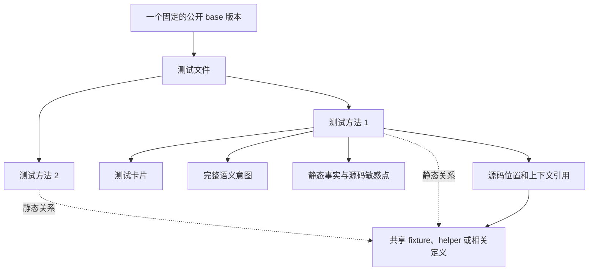
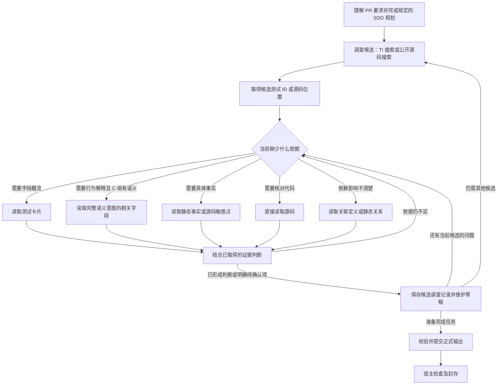

# 当前 TI 结构、三个建设阶段与三组比较说明

版本：v5。整理日期：2026-11-10。第 3.2 节区分任务要求、条件触发操作和程序校验，说明十个步骤的依赖与分支。

本文说明当前已经实现的内容。阶段进度和模型运行状态是日期化记录，后续以运行账本为准。本文件是实验工作文档，不修改正式 context，也不改变正在运行的实验。

## 1. 我们希望 TI 帮助解决什么

目标是：**只根据 PR 标题、正文和修改前的仓库，找出哪些已有测试函数或方法需要更新，优先减少漏掉的测试。**

TI 是 test intention，即对“已有测试现在在做什么”的结构化说明。它帮助 Agent 搜索和理解测试，然后由 Agent 结合本次任务判断是否需要修改。

例如，一个测试现在“在关闭重定向时检查返回状态码”，这是测试意图；“这次 PR 是否使它需要修改”，则是运行定位任务时才回答的问题。提前生成的意图不包含后一个答案。

当前增强的是直接测试定位方案：`PR title/body → 搜索和阅读测试 → 输出需要更新的测试方法`。它没有增加一轮生产代码定位，也没有把生产代码候选作为测试搜索的范围限制。

## 2. 先区分两套 A/B/C

当前文档中有两套字母，它们的含义不同。

| 称呼 | 含义 | 目前状态 |
| --- | --- | --- |
| 阶段 A | 补齐缺失的语义意图，检查质量并发布材料 | 已完成，TI-15～19 |
| 阶段 B | 提供源码敏感点、候选调查记录和共同判断规则 | 已完成，TI-20～23 |
| 阶段 C | 构建比较组、验证环境、执行实验并评价 | TI-24/25 已完成，TI-26 运行中 |
| 实验 A 组 | 不提供预先整理的 TI 材料 | TI-26 的一个比较条件 |
| 实验 B 组 | 提供静态测试事实 | TI-26 的一个比较条件 |
| 实验 C 组 | 提供相同静态事实，再加语义意图 | TI-26 的一个比较条件 |

**建设阶段按 A → B → C 推进；进入阶段 C 后，实验再分别运行 A/B/C 三组。** 阶段 A 生成的语义主要供实验 C 组使用；阶段 B 的共同判断和调查记录规则用于三组。

## 术语约定：全文统一使用以下名称

| 统一名称 | 定义 | 对应入口或字段 |
| --- | --- | --- |
| **搜索结果条目** | `search` 返回的一条匹配结果，包含测试 ID、状态、行为目标预览、检索分数和命中依据 | `search`；见第 4.1 节 |
| **测试卡片** | `show` 返回的一个测试的结构化记录，包含身份、位置、行为目标、输入／mock／场景预览、依赖候选、不确定项数量和证据引用 | `show TEST_ID`；见第 4.2 节 |
| **行为目标** | 描述该测试在验证什么的一段文字 | 完整值保存为 `intention.summary`；搜索结果条目和测试卡片以 `goal` 字段展示 |
| **完整语义意图** | 一条完整的模型生成记录，包含行为目标、操作、输入、环境与 mock、场景及不确定项 | `detail`、`scenarios`；见第 4.3 节 |
| **证据材料** | 用于核对完整语义意图和更新判断的静态事实、源码、关联定义、静态关系及来源信息 | `facts`、`maintenance`、`source`、`contexts`、`relations` 等；见第 4.4 节 |
| **候选调查记录** | Agent 对已调查测试保存的任务要求、修改理由、支持与反对依据、不确定项及选择状态 | 保存于允许的规划目录；见第 7 节 |

本文中的“预览”仅指原字段中按展示限制返回的内容，不是一份独立生成的数据。列表预览通过 `items`、`total`、`more`、`read` 说明已显示什么、还剩多少及如何继续读取；行为目标预览的限制如下。

同一个行为目标有三种读取方式：搜索结果条目的 `goal` 最多取前 120 字符；测试卡片的 `goal` 在完整文字不超过 350 字符时原样显示，超过则令 `goal` 为 null，并通过 `goal_read` 提供读取入口；`detail TEST_ID --field summary` 读取完整值。这三种方式读取同一份 `intention.summary`，不会分别调用模型生成。没有完整语义意图时，保留对应缺失状态。

搜索结果条目用于发现候选，测试卡片用于查看一个测试的字段。完整语义意图用于理解测试行为，证据材料用于核对具体依据；需要修改哪些测试由 Agent 结合 PR 要求判断。测试卡片也包含证据引用，因此这些名称区分的是对象及用途，不代表彼此完全没有字段重叠。

## 3. 当前 TI 的整体结构

### 3.1 用层级目录组织，用关系连接不同测试



文件与测试的归属适合树状组织；共享 fixture、调用候选等关联需要额外的关系边。一个 fixture 可以被多个测试引用，也可能跨文件，因此整体包含关系图。

当前类名保存在测试限定名和所属信息中，不必把每个类另建成独立目录节点。典型测试 ID 为：

```text
tests/test_example.py::ExampleTest.test_method
tests/test_example.py::test_function
```

base 版本由外层材料包固定。同名测试在不同 base 下可能有不同源码和意图，所以统计材料规模时需要区分版本。

树和关系用于导航。Agent 仍然可以搜索该 base 下的全部测试，不需要先选中文件或生产代码才能访问某个测试。

### 3.2 搜索结果条目、测试卡片与证据材料分开

这一节描述 Agent 接到一条 PR 后，怎样逐步找到并判断需要更新的已有测试。完整语义意图和证据材料已经提前存好，下面的操作是读取与判断，不会重新生成 TI。

带有完整语义意图的步骤适用于实验 C 组；实验 B 组使用相同静态事实和证据材料，但不提供生成的行为目标、输入说明或场景；实验 A 组通过搜索和阅读公开源码完成调查，没有 TI 读取入口。三组都需要依据任务与源码判断，并使用相同的候选调查记录和最终输出规则。

下面的十个步骤按照便于说明的顺序编号，实际运行存在分支、循环和可以跳过的读取操作。读取器不会自动替 Agent 走完所有步骤。

#### 步骤之间的关系与执行要求

先区分“提示要求 Agent 做”和“程序会检查并阻止不合格结果”两层。任务理解、证据判断及候选调查记录主要由提示要求；工具不会验证 Agent 是否真正读懂了任务或源码。最终输出结构、允许写入范围、封存状态等则有程序检查。不能把提示要求当成已经得到程序保证的事实。

| 步骤 | 执行性质 | 前置条件与允许的分支 |
| --- | --- | --- |
| 1. 理解 PR 要求 | 每项任务都要求做 | 读取公开任务输入；后续调查和判断应以该要求为依据 |
| 2. 搜索候选 | 任务需要调查，具体方式由组别和 Agent 决定 | B/C 提示明确要求读取材料指南并使用 `search`；A 通过公开源码调查。程序没有规定查询次数或必须遍历所有测试 |
| 3. 阅读搜索结果条目 | 使用 `search` 后才适用 | 可以继续翻页、换查询，或根据已有位置直接核对源码；不要求读取全部结果 |
| 4. 读取测试卡片 | 按需选择的读取操作 | 需要有效测试 ID；ID 可以来自 TI 搜索，也可以来自源码搜索。不必先执行 `show` 才能读场景或源码 |
| 5. 读取完整语义意图 | C 组中按需选择 | 该测试有对应生成字段，而且当前判断需要这些信息。B 组及无语义测试跳过；也可只读取一个字段 |
| 6. 核对事实与源码 | 源码依据是判断要求；各读取命令按需选择 | 不必把 `sensitive`、`point`、`facts`、`source` 全部调用。可直接读公开源码；不能只凭相关性分数判断更新必要性 |
| 7. 查看关联定义与静态关系 | 按需选择 | 需要弄清 fixture、helper、继承或其他依赖的影响时展开；不要求每个测试都查关系 |
| 8. 判断并记录候选 | 对实际调查过的候选，提示要求判断并保存候选调查记录 | 可选中、排除或待确认；只出现在结果中不等于已调查。达到记录上限时披露缺口并继续调查，不限制最终候选数量 |
| 9. 继续调查与保存草稿 | 继续调查由证据缺口触发；保存可修订草稿是提示要求 | 发现未解决的问题时补充查询或阅读；没有新证据不必反复查询、保存或修订 |
| 10. 提交与封存 | 成功完成任务必须有正式输出，宿主执行封存检查 | 提示要求按公共工具完成校验和发布；宿主重新检查输出并按实际策略处理错误，之后才能封存 |

三种 SDD 各自要求的 Detect 规划阶段和规划产物仍需完成。它们贯穿调查及收尾过程，没有因为上表展示了 TI 阅读步骤就被取消；上表也不代表一个额外的生产代码定位阶段。



**工具前置条件与固定调用顺序不同。** `show`、`scenarios`、`facts`、`source` 等需要一个有效测试 ID，但不要求 ID 一定由 `search` 返回；`point` 需要属于当前测试的事实引用，关联源码读取需要属于该测试的上下文 ID。`sensitive` 和 `contexts` 是取得这些引用的常用方式，引用也可以来自其他合法读取结果。

搜索翻页需要上一页的 `next_cursor`，并保持查询与选项相同；其他视图继续读取时使用返回的 `next_offset`。只有当前判断依赖未展示内容时，才有必要读取相应后续页或分片；若需要理解整条分片记录，则应收集完整分片，不能把片段当作完整记录。

**“按需选择”允许灵活选择取得依据的方式，不表示可以在依据不足时直接下结论。** 例如，`show` 后已经有明确的原文引用，可以直接核对源码；已经直接读懂源码，就不必为了凑齐步骤再读相同内容的完整语义意图。如果证据不足，可以继续调查并保存待确认项，不应把缺少语义或未命中查询当作排除依据。

已调查候选的记录和草稿保存是提示要求，但目前不会逐项验证所有已调查候选是否都有记录，也不强制至少调用一次特定 TI 工具。宿主会检查正式输出：结构不合法会阻止封存；无效测试身份保留在预测中按误报处理。若存在进度草稿，它必须处于已发布状态、与最终输出一致且无未解决的 pending 项，否则拒绝封存。不能将这套实现概括成“十步均被强制执行”或“所有身份错误都无法提交”。

真实读取结果的逐步演示见[一次 TI 搜索与候选判断的演示](TEST_INTENTION_SEARCH_WALKTHROUGH.md)。该演示使用虚构 PR 和公开 base，不是实际实验预测。

#### 第一步：从 PR 中明确需要调查的变化

Agent 先阅读 PR 标题和正文，识别任务明确提出的行为变化、API 迁移、默认值变化、mock 约定变化或类型要求。它需要把这些要求整理成可以与当前源码核对的问题。

例如，下面使用一个虚构任务说明流程：PR 要求把旧调用 `client.fetch(url)` 迁移为 `client.request(url)`。待调查的问题包括：哪些测试方法直接调用 `fetch`？哪些 mock 仍然替换 `fetch`？是否存在兼容入口？是否只需改共享 helper？

这一步不读取实现 diff 或最终测试补丁，也不提前假定开发者最后一定采用某种修改方式。PR 没有说明的兼容性和迁移范围保持待确认。

#### 第二步：用查询词搜索全部测试

Agent 从任务中选择 API 名称、配置键、异常名或行为词，调用 TI 读取器。例如：

```bash
python3 test-intentions/read.py search --query fetch
```

读取器检查当前组允许检索的完整字段。实验 B 组检查测试身份、静态调用、断言、导入及其他已有事实；实验 C 组还检查完整语义意图中的行为目标、输入、操作、环境与 mock、场景和不确定项。默认搜索范围是当前 base 的全部测试。

读取器先做查询匹配，再按固定的相关性规则排序，返回一页搜索结果条目。它不会自动改写查询、调用另一个模型判断修改必要性，或把证据材料全部返回。

多个 `--query` 默认表示任意一个匹配即可；`--mode and` 要求每个查询都匹配。当前主要是字面匹配，因此一个查询没有命中时，Agent 可以更换代码名称或行为词，也可以直接搜索公开源码。没有命中不等于没有相关测试。

**这一步的实现分工：**Agent 根据 PR 自行选择查询词并通过命令工具执行搜索。系统没有一个自动路由器决定“走 TI 还是走源码”，也没有预先固定“先查 TI、失败后再查源码”的程序分支。B/C 提示要求使用 TI 搜索入口，同时允许源码调查；A 没有 TI 材料，因此通过公开源码调查。两条路径可以交替使用。

| 路径 | 实际实现 | 返回给 Agent 什么 |
| --- | --- | --- |
| TI 搜索 | `read.py search` 读取本组 `.search.sqlite3` 的字段、词频向量和统计；先做忽略大小写的字面子串匹配，默认 OR，可选 AND；对匹配项使用字段加权的 BM25 类公式排序，同分按测试 ID 排序，再分页 | 搜索结果条目、命中总数、本页返回数和游标 |
| 公开源码搜索 | Agent 使用 `git grep`、`grep`、可用时的 `rg` 或 Python，直接查固定 base 的源码文件；例如 `git grep -n -F 'redirect_times' -- tests` | 文件路径、行号和命中的源码文本，具体形式由所用命令决定 |

TI 搜索的词频向量是预先统计的词与次数，不是 embedding 向量。当前不会为每次查询调用语义检索模型，也不会让另一个 LLM 决定相关性。数据库在材料构建阶段准备好；搜索时按固定算法读取和计算。B 的索引只含静态允许字段，C 额外含完整语义意图的允许字段；原始源码全文不自动等于 TI 索引中的检索字段。

源码搜索没有统一的 TI 相关性分数，也不会自动返回测试 ID、测试卡片或将命中行映射为最终候选。Agent 要继续阅读周围定义，确认所属函数／方法和修改必要性。通过源码得到有效测试 ID 后，也可转回 TI 读取入口。

因此本步骤只是找到值得继续调查的位置。当前没有自动合并两条路径的排名、自动判定搜索是否足够完整，或仅凭命中就把测试写入最终输出的机制。查询词、翻页、切换路径和后续判断仍由 Agent 决定。

#### 第三步：阅读搜索结果条目，确定继续调查的候选

Agent 查看每条结果的测试 ID、行为目标预览（如有）、命中字段和原文片段，判断它与任务的关系。例如，`fetch` 出现在直接调用中，与出现在一个无关字符串中的调查价值可能不同。

`score` 只说明检索相关性。Agent 不能因为分数高就直接选中，也不能因为分数低、行为目标为空或语义状态为回退就直接排除。此时确定的是“值得进一步阅读的候选”，还不是最终更新目标。

搜索结果的匹配总量与本页实际返回量分开显示。如果还有后续结果，Agent 根据需要携带返回的 `next_cursor` 继续读取；游标必须用于相同查询与选项。当前默认一次输出最多 6,000 UTF-8 字节、8 个单位，实际返回数量也会受字节限制影响。

没有被阅读的后续结果仍然可能包含相关测试。因此，首屏没有目标与完整匹配集合没有目标，是两种不同情况。是否翻页及何时换查询由 Agent 在预算内决定。

#### 第四步：读取一个候选的测试卡片

确定候选后，Agent 使用搜索结果中的真实测试 ID：

```bash
python3 test-intentions/read.py show 'tests/test_example.py::ExampleTest.test_method'
```

测试卡片集中展示该方法的身份、源码位置、行为目标（如有）、输入／mock／场景预览、静态依赖候选、不确定项数量和证据引用。它帮助 Agent 确认“这是哪个测试、目前掌握哪些行为信息、接下来需要读什么”。

列表中的 `total` 是总量，`more` 是尚未显示的数量，`read` 是继续读取入口。如果某个场景过长，测试卡片可能没有显示任何场景，但仍会给出实际总量。Agent 不能把“当前没有显示”理解成“原记录不存在”。

实验 B 组的测试卡片没有生成的行为目标及场景。Agent 可以直接进入静态事实和源码阅读。实验 C 组遇到 `STATIC_FALLBACK` 时也按这个方式继续调查。

#### 第五步：只展开影响当前判断的完整语义意图

实验 C 组中，如果测试卡片已经清楚显示当前所需内容，可以直接核对证据材料；如果关键字段未显示或存在歧义，就继续展开。例如：

```bash
python3 test-intentions/read.py detail 'TEST_ID' --field summary
python3 test-intentions/read.py detail 'TEST_ID' --field operations
python3 test-intentions/read.py scenarios 'TEST_ID'
```

第一条读取完整行为目标，第二条读取操作列表，第三条读取场景中的条件、动作、预期和证据 ID。其他字段也可以通过 `detail` 单独读取。这里的 `TEST_ID` 需替换为实际返回的测试 ID。

例如，测试卡片只显示“验证请求失败”，不足以判断 API 迁移是否影响它；展开场景后，可能发现测试先替换 `fetch` 的返回值，再检查异常。这会提供下一步需要核对的 mock 位置。

完整语义意图是模型对已有源码的解释。它能帮助理解，但仍需要证据材料核对；只查看一段行为目标不能证明某个方法必须修改，也不能证明它无需修改。

#### 第六步：核对静态事实和具体源码

Agent 根据尚未解决的问题选择读取入口。例如：

```bash
python3 test-intentions/read.py sensitive 'TEST_ID'
python3 test-intentions/read.py point 'TEST_ID' --ref '/facts/calls/0'
python3 test-intentions/read.py facts 'TEST_ID' --field assertions
python3 test-intentions/read.py source 'TEST_ID'
```

`sensitive` 返回源码敏感点目录；`point` 展开一个原事实及来源；`facts` 读取指定类别的静态事实；`source` 读取测试源码。示例中的事实引用必须换成当前测试实际返回的引用，不能假定每个测试都存在 `/facts/calls/0`。

如果问题来自搜索命中，也可以用 `match TEST_ID --ref ...` 回查命中的原字段。它返回的是对应材料字段，不等于已经读取源码；需要确认具体代码时仍要使用源码读取入口。

回到前面的虚构任务，Agent 要确认：`fetch` 是否真的出现在该方法中？它是直接调用、mock 目标，还是不相关字符串？当前断言检查什么？是否存在兼容接口？这些具体事实共同支持后续判断。

工具会按固定 base 的来源和哈希回查源码。旧静态事实有些只记录表达式起始行，遇到多行调用时应继续读完整方法。其他视图使用返回的 `next_offset` 继续读取；超大记录以明确标记的分片返回，需要收集相关分片后再理解完整内容。

#### 第七步：必要时查看关联定义和静态关系

如果测试调用了 helper，或输入由 fixture 准备，Agent 可能需要继续读取：

```bash
python3 test-intentions/read.py contexts 'TEST_ID'
python3 test-intentions/read.py relations 'TEST_ID'
python3 test-intentions/read.py source 'TEST_ID' --ref 'CONTEXT_ID'
```

`contexts` 返回该测试已关联定义的身份和位置；`relations` 返回已保存的静态关系。Agent 再使用实际返回且属于该测试的 `CONTEXT_ID` 读取关联定义源码。

例如，测试本身只调用 `fetch_page()`，而 `fetch_page()` 内部调用旧 API。如果修改 helper 就足够完成迁移，测试方法本身可能无需编辑。反过来，测试方法中若还固定写有旧 mock 目标，则需要继续核对该方法的修改必要性。

关系可以提示其他值得调查的测试，但当前流程不自动把所有关联测试加入最终候选。发现另一个测试后，仍需单独核对任务与该方法的对应关系。关联提取也有范围限制，缺少关系边不代表源码中没有依赖。

#### 第八步：判断方法本身是否需要修改，并保存候选调查记录

读到足够依据后，Agent 把 PR 要求与当前方法中的调用、引用、mock、断言、配置或注解逐项对应，说明为什么这个已有方法本身需要编辑，或为什么当前证据不支持编辑。

例如：任务明确废弃旧 API，而该方法直接调用旧入口，可以支持选择；仅生产代码内部重构，当前测试接口和断言仍有效，则不能只凭相关性选择；只修改共享 helper 即可，则应与方法内容更新目标区分。最终断言不变也不自动排除方法内的 API 引用维护。

对实际调查过的候选保存候选调查记录，包含任务要求、修改范围、方法修改理由、支持与反对依据、不确定项及状态。状态为 `selected`、`excluded` 或 `pending`。不要求对全库所有测试逐一写记录。

候选调查记录保存在规划目录，与最终定位输出分开。它有大小和修订次数限制，达到记录上限不应截断最终候选。保存工具检查格式和公开源码身份，不替 Agent 判断选择是否正确，也不启动额外模型评审。

#### 第九步：补充调查，同时保存可更新的定位草稿

如果仍有待确认候选、尚未覆盖的任务要求，或已知有价值的后续结果，Agent 可以返回第二步补充查询、返回第三步翻页，或继续读取当前候选的完整语义意图与证据材料。

随着调查推进，Agent 保存并更新定位草稿。草稿允许继续修订，待确认问题单独记录；过程中的候选不会因为第一次被选中或排除就永久固定。

Agent 同时需要为正式输出留出时间和预算。完整调查路径不是要求每个候选调用所有工具，而是缺什么依据就读取什么，避免反复返回相同材料。读取到模型上下文中的内容会消耗定位预算；磁盘中没有被读取的材料不会因为存在那里就全部占用该预算。

#### 第十步：校验并提交最终定位结果

收尾时，Agent 按公共输出约定组织最终候选：使用真实路径、函数／方法限定名和修改理由。没有候选时按约定输出空候选数组；不能用缺失或未完成文件代替一次明确的空输出。

公共校验器检查两层内容：JSON 的根节点、字段和类型等结构约束，以及路径、符号是否对应允许 base 中的真实测试身份。它不访问隐藏标签，也不判断这些测试在历史补丁中是否真的被修改。

Agent 按提示完成校验和提交后，宿主执行器会重新检查输出。结构不合法会阻止封存；无效测试身份会保留在预测中按误报处理。若保存过进度草稿，还需确认它已发布、与正式输出一致且没有未解决的 pending 项。候选调查记录不会自动变成最终定位结果，临时草稿也不会仅因为已经保存就自动视为成功输出。

TI-26 的 27 项全部终结后，宿主评价流程才统一计算指标。输入模型的调查过程与宿主标签评价分开；本节描述的是单项定位任务，不提前使用最终分数修正仍在运行的候选。

## 4. 每条测试具体保存哪些内容

### 4.1 搜索结果条目：`search` 返回的单条结果

| 字段 | 含义 | 阅读时应注意什么 |
| --- | --- | --- |
| `id` | 文件路径和函数／方法限定名 | 用于展开、源码回查和最终输出 |
| `status` | 语义是否可用，或该组只提供静态材料 | `GENERATED` 是有生成语义；`STATIC_FALLBACK` 是没有可用语义；B 组统一为 `STATIC_ONLY` |
| `goal` | 行为目标预览 | 搜索结果最多展示 120 字符；没有语义时可能为空 |
| `goal_truncated` | 行为目标是否被截短 | 为真时需读取完整行为目标 |
| `score` | 查询与该测试材料的检索相关性 | 不是“必须修改”的概率，也不是最终选择依据 |
| `hit` | 一个命中字段、原文片段和证据引用 | 可回查具体命中位置；搜索结果条目只展示代表性命中 |
| `matching_fields` | 有多少个不同字段命中 | 帮助理解命中分布；不是测试需要修改的证据数量 |

搜索会检查允许检索的完整字段，不只检查测试卡片中已显示的内容。当前主要是字面匹配和字段加权排序；生成了语义，不代表任何同义任务词都会自动命中。

### 4.2 测试卡片：`show TEST_ID` 返回的内容

| 字段 | 含义 |
| --- | --- |
| `id`、`location` | 测试身份、文件和起止行 |
| `status` | 该测试的语义可用状态 |
| `goal`、`goal_read` | 行为目标；不超过 350 字符时原样显示，超过时 `goal` 为 null，`goal_read` 提供完整读取入口 |
| `inputs` | 输入预览，例如参数、对象属性和配置值；未显示的条目通过 `more` 和 `read` 说明 |
| `mock` | 环境与 mock 预览，例如替换的方法和提供的返回值；未显示的条目通过 `more` 和 `read` 说明 |
| `scenarios` | 场景预览，展示条件、预期及证据引用；未显示的场景通过 `more` 和 `read` 说明 |
| `dependency_candidates` | 静态分析得到的依赖候选，例如关联 fixture 或定义 |
| `uncertainty_count` | 静态分析及生成描述中不确定项的数量 |
| `hints_status` | 当前为 `NOT_SEPARATELY_GENERATED`，表示没有单独生成论文模板中的“提示”字段 |
| `evidence` | 该测试的证据引用 ID，与测试 ID 相同，可用于回查对应证据材料 |

预览列表中的 `total` 表示总量，`more` 表示尚未显示的数量，`read` 提供展开入口。测试卡片没有显示场景，不等于没有场景；例如第一条场景太长时，预览可能为空，但 `total` 和 `more` 会保留实际数量。

### 4.3 完整语义意图

完整语义意图可以按字段读取，逻辑结构如下：

```text
intention
├── id                  对应哪个已有测试
├── summary             测试的行为目标
├── operations          执行了哪些主要操作
├── inputs              使用了哪些输入
├── environment_mock    运行环境、fixture 和 mock 行为
├── scenarios           一个或多个场景
│   ├── conditions      场景成立的条件
│   ├── actions         在这些条件下做了什么
│   ├── expected        源码已经表达的预期
│   └── evidence        测试及允许上下文的证据 ID
└── uncertainties       无法仅从现有证据确认的事项
```

这个结构对应最初提出的“被测操作、输入、环境与 mock、条件链、已有测试预期、不确定项”。条件链通过多个场景及各自的条件、动作、预期来表达，没有单独保存为控制流树。

完整场景保存 `actions`，测试卡片的场景预览主要展示 `conditions`、`expected` 和 `evidence`。需要完整动作时应展开场景。

语义是模型对源码的解释。证据 ID 校验可以检查引用是否属于允许范围，不能单独证明描述正确、场景完整或模型理解无误。

### 4.4 静态事实、上下文与源码敏感点

| 内容 | 当前保存或提供的信息 | 用途 |
| --- | --- | --- |
| 方法内静态事实 | 调用、赋值、断言、条件／循环、mock、参数化／装饰器 | 找到可能受任务影响的表达式 |
| 维护相关事实 | 类型注解、导入、继承候选、关联定义中的调用、导入外层条件 | 补充仅看行为目标容易遗漏的维护线索 |
| 上下文引用 | 已关联的 fixture、helper、setup 或其他定义的身份和源码位置 | 在必要时理解环境与依赖，覆盖有边界 |
| 静态关系 | 已保存的关联和依赖候选 | 从一个测试找到相关定义或共享依赖 |
| 来源信息 | 文件、行号、引用、文件哈希及不确定性 | 确认事实属于当前 base，并回查源码 |

“源码敏感点”是以上事实的一种便于阅读的展示。例如任务迁移旧 API，当前测试中调用旧 API 的位置可以成为敏感点。

`sensitive` 返回源码敏感点目录，每个表达式预览最多 160 字符，并标明是否截短；`point` 展开一个事实及来源。它们复用已有字段，没有为每个 PR 预先生成“哪些行必须修改”的结论。部分旧事实只记录起始行，需要继续读取整个测试才能看到多行表达式。

静态关系不证明运行一定经过该依赖，也不表示所有关联测试都需要修改。当前三组比较保留静态关系，关闭生成的语义文件主题和新增语义关系，不做自动关系扩展。

## 5. 磁盘里的“材料包”和“生成输入包”分别是什么

### 5.1 每个 base 的材料包

当前三组比较的 B/C 材料格式为 `matched-intention-v1`，来源是阶段 B 验收的 `compact-intention-v6`。

```text
某一个 base 的材料目录/
├── README.md                 阅读方式和解释边界
├── index.json                按文件组织的目录与入口
├── summaries/*.jsonl          按原测试文件组织的测试卡片
├── .evidence.sqlite3          完整语义意图、静态事实、上下文引用与静态关系
├── .maintenance.sqlite3       已提取的维护相关事实
├── .search.sqlite3            本组允许内容的检索索引和统计
├── read.py 及辅助读取脚本     限量读取、分页和回查
├── field-contract.json        字段约定
├── relations.json            关系读取指引
└── manifest.json             来源和完整性清单
```

所以当前同时使用 JSON／JSONL 和 SQLite。Markdown 用于说明；结构化数据用于搜索和按需读取。源码通过公开 base 中的路径和行号回查，精简数据库不复制整份源码。

默认一次读取最多 6,000 UTF-8 字节、8 个输出单位，最高 12,000 字节、25 个单位。不同视图使用游标或偏移继续读取；超大记录明确分片。这些是单次工具输出限制，不是整个任务的 token 预算。

### 5.2 阶段 A 提到的 772 个生成输入包

生成输入包是离线生成时发给模型的一份任务：包含少量测试、测试源码、相关定义和允许引用的证据 ID。模型据此返回这些测试的语义意图。

一个输入包可以包含多个测试，相同完整输入在多个 base 下也可能复用。因此 **772 个输入包不等于 772 个测试，也不等于 772 个最终材料目录**。

它与前一节的材料包处于不同位置：

```text
生成输入包 → 模型生成语义 → 校验与抽检 → 每个 base 的材料包 → 定位时按需读取
```

## 6. 阶段 A：补齐语义覆盖，已经做了什么

**要解决的问题：**旧材料中，一部分测试虽然有静态记录，却没有可用语义。缺失集中在某些测试集合，不能只看全库平均值。

阶段 A 的工作包括恢复失败缓存、保留历史请求记账、精确检查证据引用、按公开 base 统一补生成、抽样核查源码，以及发布独立的新材料版本。补齐计划没有按隐藏正例优先生成。

| 项目 | 旧材料 | 阶段 A 发布后 |
| --- | ---: | ---: |
| 公开 base | 22 | 22 |
| 版本化测试记录 | 53,249 | 53,249 |
| 有可用语义的记录 | 46,975 | 53,145 |
| 仅静态回退的记录 | 6,274 | 104 |
| 语义覆盖率 | 88.22% | 99.80% |

这里的 53,249 是跨 22 个 base 的版本化记录，包含同一测试在不同版本中的记录，不代表 53,249 个跨版本去重后的方法。

772 个补生成输入包全部终结：762 个通过生成结构与引用校验，3 个失败回退，7 个结果及用量未知。随后固定抽查 48 条：45 条接受、2 条触发整包隔离、1 条确认没有语义；整包隔离合计撤下 48 条版本化语义记录。

阶段 A 最终发布 `compact-intention-v5`，旧材料和生成记录均保留。**99.80% 表示语义可用覆盖，不是语义正确率，更不是定位召回率。** 固定样本抽查也不等于全库人工审查。

阶段 A 的生成使用订阅生成渠道；当前 TI-26 的 DeepSeek 定位调用单独记账，二者预算不同。

证据：[阶段 A 完成报告](TEST_INTENTION_STAGE_A_RESULTS.md)。

## 7. 阶段 B：让任务要求对应到源码，已经做了什么

**要解决的问题：**有意图不等于会检索到；检索到不等于读到关键位置；读到后仍可能误判是否需要修改。

| 任务 | 已完成的工作 | 实际作用 |
| --- | --- | --- |
| TI-20 | 提供 `sensitive`／`point` | 将已有事实整理成可回查源码的敏感点 |
| TI-21 | 提供候选调查记录工具 | 记录候选为什么选中、排除或待确认，便于事后分析 |
| TI-22 | 统一三种 SDD 的判断规则和成对例子 | 同时约束过严排除与过宽选择 |
| TI-23 | 固定查询和历史查询的离线回放 | 分开观察检索、首屏展示、阅读入口和最终选择的问题 |

例如，任务明确迁移某 API，而测试方法直接调用旧入口，可以支持继续调查本地修改；但若只需改共享 helper，不能因此自动选中所有使用它的测试。

候选调查记录包括：任务要求、测试 ID、选中／排除／待确认、方法本身的修改理由、支持与反对证据、不确定项，以及返回过什么材料。记录写入允许的规划目录，不改变正式定位输出。它是 Agent 的过程说明，保存成功不代表判断正确。

阶段 B 已检查全部 53,249 条测试所映射的 1,398,318 个版本化事实位置，完成相关读取、原子写入和输出契约检查，发布 `compact-intention-v6`。没有新增语义生成，没有在该阶段运行新的 SDD 定位模型。

它保留阶段 A 的语义、测试卡片和搜索索引，主要增加按需读取入口与共同判断规则。离线固定查询的结果也揭示了限制：

| 固定查询指标 | 旧 P2 材料 | 新版材料 |
| --- | ---: | ---: |
| 全匹配集合宏召回 | 83.72% | 85.56% |
| 首屏宏召回 | 38.79% | 36.49% |

完整翻页能到达的目标增加，但首屏目标反而减少。因此当前不能只凭补齐覆盖或离线检索结果宣称最终定位提升。

证据：[阶段 B 完成报告](TEST_INTENTION_STAGE_B_RESULTS.md)、[字段与命令说明](TEST_INTENTION_STAGE_B.md)。

## 8. 阶段 C：公平比较，具体要做什么、已做什么

### 8.1 已完成：TI-24 材料隔离

分别构建实验 B/C 两套材料。两组的测试身份、静态事实、维护事实、源码来源和静态关系一致；C 额外提供完整语义意图。

B 从新数据库创建，不把 C 的语义删掉后直接复用旧数据库；检索索引和统计也只从本组允许内容重建。这样避免 B 虽然不显示语义，却仍受到旧语义残留或词频统计影响。

B/C 各有 22 个 base、53,249 条测试。C 有 53,145 条可用语义、104 条静态回退。实验 A 组不挂载 TI 材料。

### 8.2 已完成：TI-25 离线运行验收

已准备全部 27 项小批工作区，检查共同任务文本、base、初始化 SDD 文件和输入隔离。69 项自动检查通过；两种实际 base × 三种 SDD × 三组，共 18 种实际容器组合全部通过。

这些检查证明材料和执行路径满足已检查的约定，尚不证明定位效果提高。

### 8.3 正在执行：TI-26 三组小批

固定 PR8064、8067、8073，分别运行 OpenSpec、Spec Kit、CC-SDD，每种运行实验 A/B/C 三组，各一次正式尝试，共 27 项。

统一采用 `deepseek-flash/high`，每项 100,000 rollout 预算、2,700 秒时限。最多三条 SDD 队列并发，同一 PR×SDD 的三组按冻结顺序串行，失败不重试。

费用边界已由用户确定：**仅使用现有 DeepSeek 余额，不充值；余额不足即停止新派发。** 已开始项保留结果，未开始项明确记为阻塞。

本文件核查时刻为 **北京时间 2026-11-10 11:18:43**：

| 状态 | 数量 |
| --- | ---: |
| 已完成并封存 | 4 |
| 正在运行 | 3 |
| 尚未派发 | 20 |
| 失败／阻塞 | 0 |

这些是运行状态，尚未计算本轮定位指标。全部 27 项进入终态后再统一评价，不根据中途分数调整后续组。

### 8.4 尚未开展：TI-27／28

TI-27 是后续正式范围的匹配比较；是否开展和实际预算仍由用户决定，当前不会自动扩大到 30 PR 的 270 项。

TI-28 汇总最终指标、成本、失败类型与局限。当前 30 PR 一直作为开发诊断集，其结果不能代替未参与调优任务上的泛化评价。

证据：[三组材料与小批说明](TEST_INTENTION_MATCHED_PILOT.md)、[完整任务清单](TEST_INTENTION_NEXT_TASKS.md)。

## 9. 实验 A/B/C 三组分别怎样完成同一个任务

| 条件 | A：无 TI | B：仅静态事实 | C：静态事实＋语义意图 |
| --- | --- | --- | --- |
| PR title/body、公开 base | 相同 | 相同 | 相同 |
| 预先整理的 TI 材料 | 无 | 有 | 有 |
| 静态事实、维护事实、上下文与关系 | 自行读源码调查 | 可通过材料读取 | 与 B 相同 |
| 完整语义意图中的行为目标、输入、操作、mock、场景 | 不提供 | 不提供 | 提供已验收记录 |
| 生成状态 | 不提供 | 全部统一 `STATIC_ONLY` | 显示 `GENERATED`／`STATIC_FALLBACK` |
| 源码阅读权限 | 有 | 有 | 有 |
| 模型、预算、共同判断规则和最终评分 | 相同 | 相同 | 相同 |
| 最终任务 | 找出需更新的已有测试方法 | 相同 | 相同 |

**A 组的实际路径：**阅读 PR，使用源码搜索和文件阅读找到测试，核查任务与方法的对应关系，输出候选。它是当前修复后环境中的直接定位对照，不能用历史旧运行替代。

**B 组的实际路径：**阅读同一 PR，通过静态字段搜索候选，查看调用、导入、mock、断言等事实及源码敏感点，必要时展开源码，再判断和输出。它仍然需要推理测试行为，只是获得预先整理的源码事实。

**C 组的实际路径：**在 B 的能力上，还能搜索和阅读行为目标、输入、环境及场景。Agent 可用行为目标和场景理解行为，并回到具体事实和源码确认是否需要编辑。语义可能帮助理解，也可能增加阅读量、改变匹配与排序，或者引入不准确解释，收益由实验决定。

三组都遵守相同输入边界：模型不可读取实现 diff、隐藏标签、最终测试补丁或旧预测来推断答案。它们都可以调查全部 base 测试，最终仍定位已有函数／方法。

## 10. 三组结果能回答什么

| 比较 | 主要回答的问题 | 解释边界 |
| --- | --- | --- |
| B 相对 A | 提供结构化静态材料及其读取方式有没有帮助 | 包含材料检索和阅读路径的变化 |
| C 相对 B | 在相同静态基础上，额外语义是否有帮助 | 包含语义引起的匹配、排序、展示和推理变化 |
| C 相对 A | 整套 TI 增强相对直接定位表现怎样 | 是整体增强效果，不能全归因于行为目标这一字段 |

预先确定的主比较是 **C−B**，主指标为三种 SDD 等权的方法级 Macro Recall，并同时检查精确率、F1、完成率和误报。完整报告还保留 Micro 指标、逐 PR 差异、失败与空输出、用量缺失和耗时。

所有失败都保留在主报告中；不会只比较三组共同成功的任务。三种 SDD 在同一 PR 上的结果也不当成三个完全独立的 PR 样本。

这三组不能单独证明“只补齐覆盖”的收益，因为新版语义混合了旧复用和新生成的内容；也不能单独证明阶段 B 提示修改的收益，因为共同规则在三组中一致。小批只有 3 个开发 PR、每项一次尝试，结果主要用于协议检查与初步观察。

## 11. 当前成果与仍待回答的问题

| 已有事实 | 尚未证明的结论 |
| --- | --- |
| 语义可用覆盖提高到 99.80% | 语义全部正确 |
| 搜索结果条目、测试卡片和证据材料分层，可按需读取 | Agent 一定会使用最有效的阅读路径 |
| 已有源码敏感点和候选调查记录工具 | Agent 一定能正确判断更新必要性 |
| 静态组与语义组完成材料隔离 | 加入语义一定提高最终召回或 F1 |
| TI-26 已开始真实模型运行 | 当前已有完整三组比较结论 |

## 12. 代码与产物入口

| 内容 | 入口 |
| --- | --- |
| 测试卡片定义 | [compact.py](test_intention/compact.py) 的 `make_card` |
| 搜索字段与搜索结果条目 | [search_view.py](test_intention/search_view.py) |
| 源码敏感点 | [sensitivity_view.py](test_intention/sensitivity_view.py) |
| 实验 B/C 材料构建与共同说明 | [matched_materials.py](test_intention/matched_materials.py) |
| TI-26 调度、状态和终态评价 | [matched_pilot.py](test_intention/matched_pilot.py) |
| 当前 B/C 实际材料 | [materials](/data2/wangzuohit/NLPU-experiments/test-intention/stage-c-20261109-v1/materials) |
| 固定小批计划 | [pilot-plan.json](/data2/wangzuohit/NLPU-experiments/test-intention/stage-c-20261109-v1/pilot-plan.json) |
| 当前运行日志 | [workflow.log](/data2/wangzuohit/NLPU-experiments/test-intention/stage-c-20261109-v1/workflow.log) |

上表代码用于阅读实现；正在运行的小批使用单独冻结的执行根，本文档没有更改该版本或正在运行的输入。
