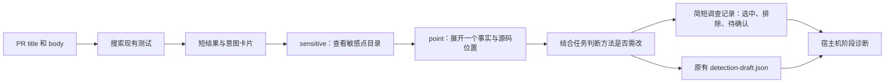

# 阶段 B：把任务要求对应到测试源码，并记录选择依据

版本：v1，2026-11-09。实施范围为 TI-20～23，只构建本地材料、公共工具和离线诊断；不启动生成或 SDD 模型调用。这里的“阶段 B”与后续三组比较中的“B 组仅静态事实”是两个不同概念。

## 这一阶段解决什么

有测试意图，不等于 Agent 会找到测试；找到了，也不等于会正确判断是否修改。阶段 B 分别提供三样东西：能回到源码的影响线索、简短的候选调查记录，以及按检索／阅读／决定拆开的离线检查。是否提高最终召回，需要后续同环境模型实验确认。



## TI-20：敏感点到底保存什么

“敏感点”是测试中可能与任务要求相关的源码位置。例如任务迁移某个 API，测试里对旧 API 的调用就是调查入口。它不表示该位置已经被判定必须修改，更不表示静态分析证明运行一定经过这里。

本版直接整理已有字段，不重新运行语义生成，也不新增 AST 提取：

| 提供的线索 | 复用的原字段 | 怎样理解 |
| --- | --- | --- |
| API 或构造调用 | `facts.calls` | 保存调用表达式与候选；单凭语法不能确定是构造函数、普通函数还是动态对象 |
| 赋值、固定值、配置 | `facts.assignments` | 保存现有赋值；不自动推断它是否覆盖全局默认配置 |
| 断言与预期 | `facts.assertions` | 展示实际断言表达式；不替 Agent 判断新需求是否会使其失效 |
| 条件与循环 | `facts.conditions` | 分支或迭代语法；不声称条件在运行时为真 |
| mock 表达式 | `facts.mock` | mock 调用及相关语法；绑定和实际执行仍需核对 |
| 参数化与装饰器 | `facts.parameters` | 原测试定义中的参数化入口；参数实例不变成多个计分方法 |
| 类型注解 | `maintenance.annotations` | 原源码类型表达式；缺少注解不自动构成修改依据 |
| 导入与引用 | `maintenance.imports` | 已提取的词法绑定候选；不保证完整动态解析 |
| 继承来源 | `maintenance.inheritance` | 已保存的基类表达式及候选；不是运行时完整 MRO |
| 关联定义中的调用 | `maintenance.context_calls` | 先前关联的 helper、fixture 等定义中的有限调用；不等于测试直接调用或必然执行 |
| 导入外层条件 | `maintenance.guards` | 关联导入的条件表达式；分支真值未知 |

字符串、mock 目标、固定断言值保留在原表达式里。本版不额外猜测“这一定是配置键”或“这一定是构造入口”。已有的上下文提取上限继续披露，空字段不是无关证明。

### 两个新增命令

```bash
python3 test-intentions/read.py sensitive '文件::类.方法'
python3 test-intentions/read.py point '文件::类.方法' --ref '/facts/calls/0'
```

`sensitive` 是目录：类型、最多 160 字符预览、是否截短、所属范围、路径与行号、证据引用及不确定项数量。`point` 展开该测试关联的一个原事实，返回完整表达式、来源、文件哈希、不确定性和源码行。不能用一个测试的 ID 展开另一个测试的事实。

旧事实只记录表达式起始行，因此本版明确标为“仅起始行，完整跨度未知”；多行表达式不会伪装成精确单行范围。需要整个方法时继续使用 `source TEST_ID`。较新的维护事实保留原 UTF-8 列位置。源码哈希发生变化会拒绝回查，避免把事实指向另一版代码。

默认 `search` 和 `show` 不变；这两个新命令按需使用。输出默认最多 6,000 字节，上限 12,000 字节；大记录使用明确标记的分片，跟随 `next_offset` 可以还原完整记录。来源样例见产物目录的 `source-examples.json`。

## TI-21：只为实际调查过的候选记短记录

调查记录回答：“任务要求是什么，当前方法哪里与它对应，为什么方法本身需要编辑，以及还有什么反对依据或未知项？”它不是要求为全库测试逐条写分析。

| 字段 | 内容 |
| --- | --- |
| `id` | 公开 base 中真实存在的测试身份 |
| `task_requirement` | 这次调查对应的任务要求，最多 240 字符 |
| `state` | `selected` 选中、`excluded` 排除、`pending` 待确认 |
| `edit_scope` | 方法内容、仅 helper、测试身份变化、新测试或未知；后两类在已有调查身份下讨论，不能成为方法内容目标 |
| `method_edit_reason` | 为什么方法本身需要／不需要改，最多 300 字符 |
| `support`、`against` | 支持与反对依据，各最多 3 条，可附源码位置或材料引用 |
| `unknowns` | 待确认问题，最多 3 条 |
| `exposure` | 只看到名字、完整结果可见、源码已展开三种状态之一，及对应引用 |

这些内容是 Agent 报告的观察和决定；结构检查不能证明它真的理解了代码，保存成功也不代表选择正确。

```bash
python3 /run/sdd-public/decisions.py save \
  --directory 方法允许的规划目录 --repository /workspace < note.json
python3 /run/sdd-public/decisions.py status --directory 方法允许的规划目录
```

通用短例见 [decision-example.json](../sdd-bench/scrapy-sdd/batch/public_detect/decision-example.json)。必须替换为实际测试与依据。保存时只检查公开源码身份与记录格式，不访问标签。

记录写在规划目录的 `.detect-progress/candidate-decisions.json`，保留最多 3 次修订，单条最多 2,200 UTF-8 字节，每轮最多 256 个被调查身份；重复保存完全相同记录不增加修订。通过文件锁串行更新并原子替换，中断不会留下半份 JSON。达到上限会明确报错，停止额外记笔记并披露诊断缺口，不能因此截断最终候选或停止必要调查。

三种 SDD 和三组输入使用同样的记录要求和限额。最终 `detection-draft.json` 的字段、身份规则与评分完全不变。保存记录不会触发额外模型评审，也不会重复运行正式输出校验。磁盘中的记录不会自动全部注入上下文；保存命令只返回简短确认。

宿主机导出入口：

```bash
python3 -m experiment.test_intention.decision_diagnostics \
  --planning 规划目录 --prediction detection-draft.json \
  --run-state DETECT_SEALED --output 新诊断文件.json
```

它区分选中并成功输出、选中但运行失败、选中却未进入最终输出、展开后报告排除、待确认。缺记录或缺输出时保持未知，不把“没记下来”当作“没调查”。

## TI-22：选中和排除使用同一套规则

公共规则在 [judgment.py](../sdd-bench/scrapy-sdd/batch/public_detect/judgment.py)，由三种 SDD 的同一 `detect_prompt` 引用，公共 README 与示例保持一致。原有身份和计分规则保留，行为保持不能自动排除维护修改，源码相关也不能自动选中。

| 可以支持进一步选择的依据 | 不能单独用作选择依据 |
| --- | --- |
| 任务明确迁移 API，当前方法直接使用待迁移入口，且兼容性核查支持本地编辑 | 只把测试移动到另一处；新建或删除测试 |
| mock 目标或调用断言与明确变化对应，方法内有需要修改的构造 | 只改共享 helper 即可，却选中所有 helper 使用者 |
| 任务明确要求受影响方法补类型，当前源码存在相应缺口 | 仅发现未注解方法，没有核对任务范围 |
| 新行为要求使当前预期或中间操作失效 | 生产内部重构，现有接口和断言仍有效，仅有相关性 |
| 变化影响测试依赖的默认值 | 测试显式固定配置，不能假定默认值变化同样影响它 |

是否要改变中间调用、引用、mock 或注解，应与任务对应。不能只问“最终断言值会不会变”。也不能要求 Agent 从信息有限的 title/body 唯一预测开发者最后选择的补丁。

历史开发案例回顾留在宿主机的 `historical-case-review.json`，不写入公开规则、例子、敏感点字段或排名。尤其 PR8002 的“32 个迁移方法”与标签中的 3 个保持身份的内容编辑不是同一集合，不能用数量混淆。标签仍是历史开发者改动的可观察集合，不等于所有合理维护方案的全集。

## TI-23：怎样做离线回放

先冻结查询与代码，再对所有输入生成排名并封存，最后才读宿主机标签评价。两类查询分开：

1. 沿用 P1 已冻结的 30 条公开 title/body 查询，不按新结果修改词语。
2. 从原 P2 的 90 份执行日志恢复实际出现的字面量 `read.py search` 查询，作为事后诊断；动态参数、未知字段、无法可靠解析的命令单独列出，不猜测它们的含义。

两类都比较旧 P2 材料与“阶段 A 语义＋B 读取入口”的新版材料。算法、权重、并列规则相同，每页统一 6,000 字节、最多 25 项，从首屏开始。历史日志原来可能采用其他 limit 或分页位置，因此这里叫“固定预算重新回放”，不是重现当时每一屏。

分别保留完整匹配集合、首屏完整可见候选、继续翻页后的候选、首个命中的位置、全量翻页字节与次数、首项卡片／命中回查成本。全量翻页验证顺序、重复、漏项和命中引用保真；它只证明可到达，不能说明 Agent 实际付出了该成本或全部读过。

历史日志只在完整结构化输出存在时确认完整结果可见；源码展开也只证明返回过源码行，不证明关键行被理解。没有 TI-21 新记录的旧运行，排除理由与方法编辑理由不能自动补写。阶段诊断保留 `UNKNOWN`，人工回顾另附日志行和置信边界。

历史查询数量多的 PR 不能充当更多独立样本；其逐查询平均只用于工具诊断。真实比较仍以 PR 为配对单位，保留全部任务与失败，开发结论不外推到未调优任务。读取字节不转换为 provider token 或费用。

## 版本与下一步

新版材料单独导出为 `compact-intention-v6`。阶段 A 的 v5、原 P2、旧日志、生成账本和历史评分不修改。正式 context 不变。

阶段 B 的验收结果与回放数字见 [B 完成报告](TEST_INTENTION_STAGE_B_RESULTS.md)。随后才是 TI-24/25 的三组材料隔离与离线运行验收，再按明确的模型调用范围和预算执行 TI-26/27。完成 B 不等于已经跑了新版 SDD 定位，也不能以离线检索改善代替最终模型指标。
