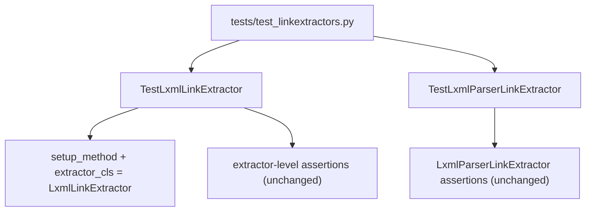

# Design Document

## Overview

**Purpose**: Make `tests/test_linkextractors.py` express the current reality of
scrapy - one link extractor implementation - by collapsing the
`Base.TestLinkExtractorBase` / `TestLxmlLinkExtractor` pair into a single
collected test class.

**Users**: scrapy maintainers and reviewers read and run this module; CI
collects it through pytest.

**Impact**: No runtime behaviour changes. The module loses one helper class and
its nested test class, and the surviving class grows to hold all extractor
assertions that already existed.

### Goals

- One collected `LxmlLinkExtractor` test class with `extractor_cls =
  LxmlLinkExtractor` and its own `setup_method`.
- Byte-for-byte equivalent test coverage: same test methods, same assertions,
  same expected test count.
- No change outside `tests/test_linkextractors.py`.

### Non-Goals

- Any change to `scrapy/linkextractors/lxmlhtml.py`, the `LinkExtractor`
  re-export, or documentation.
- Renaming, merging or relocating `TestLxmlParserLinkExtractor`.
- Introducing parametrisation, new fixtures, new assertions or new test data.

## Boundary Commitments

### This Spec Owns

- The class layout of `tests/test_linkextractors.py`: the removal of `Base`
  and `TestLinkExtractorBase`, and the placement of all extractor-level test
  methods on `TestLxmlLinkExtractor`.
- The `setup_method` / `extractor_cls` fixture wiring of that single class.

### Out of Boundary

- Production code and public API behaviour.
- Parser-level tests (`TestLxmlParserLinkExtractor`).
- Test-data files under `tests/sample_data/link_extractor/`.
- Any other test module that merely imports `LinkExtractor`.

### Allowed Dependencies

- pytest collection semantics (methods named `test_*` on classes named
  `Test*`; classes named `Base` are not collected, which is why the nested
  class exists today).
- Existing helpers already imported by the module: `HtmlResponse`,
  `XmlResponse`, `Link`, `pickle`, `re`, `pytest`, `packaging.version`,
  `w3lib`, and `tests.get_testdata`.

### Revalidation Triggers

- A new link extractor implementation is added again - then a shared base class
  becomes justified once more.
- `setup_method` or `extractor_cls` semantics change for the module.
- Pytest collection rules change for nested classes.

## Architecture

### Existing Architecture Analysis

The module currently has this shape:

```
Base                                   # not collected (not Test*)
└── TestLinkExtractorBase              # nested, holds ~32 extractor tests
    ├── extractor_cls: type | None
    ├── setup_method()
    └── test_urls_type(), test_extract_all_links(), ...

TestLxmlLinkExtractor(Base.TestLinkExtractorBase)   # collected
├── extractor_cls = LxmlLinkExtractor
└── 6 Lxml-specific tests

TestLxmlParserLinkExtractor              # collected
└── 3 parser-level tests
```

The `Base` wrapper exists only to hide the shared class from pytest, and
`TestLinkExtractorBase` exists only because the module used to define more than
one extractor test class. With a single extractor implementation, both layers
are dead weight and obscure the module's real structure.

### Architecture Pattern & Boundary Map



**Architecture Integration**:

- Selected pattern: flat test module - one collected class per unit under test.
- Domain/feature boundaries: extractor-level behaviour vs parser-level
  behaviour, expressed by the two surviving classes.
- Existing patterns preserved: `setup_method` fixtures, module-level imports,
  `tests.get_testdata` usage, pytest `skipif` marker for the w3lib version
  guard.
- New components rationale: none; this is a deletion/merger refactor.
- Steering compliance: change stays inside the module's responsibility seam and
  keeps tests as the executable contract.

## File Structure Plan

### Directory Structure

```
tests/
└── test_linkextractors.py   # only file touched: class merge + Base removal
```

### Modified Files

- `tests/test_linkextractors.py` - remove `class Base` and nested
  `TestLinkExtractorBase`; make `TestLxmlLinkExtractor` a top-level class that
  owns `extractor_cls = LxmlLinkExtractor`, `setup_method`, and every test
  method previously inherited from the base class, appended after (or merged
  with) its existing six tests. Keep `TestLxmlParserLinkExtractor` exactly as
  it is.

## Requirements Traceability

| Requirement | Summary | Components | Interfaces | Flows |
|-------------|---------|------------|------------|-------|
| 1.1-1.5 | One collected extractor test class | `TestLxmlLinkExtractor` | pytest collection | n/a |
| 2.1-2.4 | Preserved coverage | `TestLxmlLinkExtractor` test methods | pytest `setup_method` | n/a |
| 3.1-3.2 | Parser tests independent | `TestLxmlParserLinkExtractor` | direct constructor use | n/a |
| 4.1-4.3 | No production/unrelated changes | module boundary | n/a | n/a |

## Components and Interfaces

| Component | Domain/Layer | Intent | Req Coverage | Key Dependencies (P0/P1) | Contracts |
|-----------|--------------|--------|--------------|--------------------------|-----------|
| `TestLxmlLinkExtractor` | tests | Verify `LxmlLinkExtractor` behaviour end to end | 1, 2 | `HtmlResponse`, `XmlResponse`, `Link`, `get_testdata` (P0) | pytest class contract |
| `TestLxmlParserLinkExtractor` | tests | Verify `LxmlParserLinkExtractor` in isolation | 3 | `HtmlResponse`, `Link` (P0) | pytest class contract |

#### TestLxmlLinkExtractor

| Field | Detail |
|-------|--------|
| Intent | Own every `LxmlLinkExtractor`-level assertion in the module |
| Requirements | 1.1, 1.2, 1.3, 1.4, 1.5, 2.1, 2.2, 2.3, 2.4 |

**Responsibilities & Constraints**

- Class attribute `extractor_cls = LxmlLinkExtractor` so inherited test bodies
  can construct the extractor through `self.extractor_cls()`.
- `setup_method(self)` loads `tests/sample_data/link_extractor/linkextractor.html`
  into `self.response` via `get_testdata`, exactly as the current base class
  does.
- All ~32 base test methods move in unchanged; the six existing
  `TestLxmlLinkExtractor` methods stay unchanged.

**Dependencies**

- Inbound: pytest collection - only the class itself is collected.
- Outbound: `scrapy.linkextractors.lxmlhtml.LxmlLinkExtractor` - unit under
  test (Critical).
- External: `pytest` (`monkeypatch`, `skipif`), `w3lib` version - unchanged.

**Contracts**: pytest class contract. Public test symbols after the merge:
`TestLxmlLinkExtractor` and its `test_*` methods (including
`test_canonicalize_once_per_link`, `test_skip_bad_links`, and the three
`test_link_allowed_is_false_*` cases).

**Implementation Notes**

- Integration: none - test-only change.
- Validation: run `pytest tests/test_linkextractors.py` and confirm the same
  test count and result as before the merge.
- Risks: accidentally dropping a method while moving it, or leaving the class
  inheriting from a deleted `Base`; both are caught by collection errors and
  the test count check.

#### TestLxmlParserLinkExtractor

| Field | Detail |
|-------|--------|
| Intent | Keep parser-level coverage separate from extractor-level coverage |
| Requirements | 3.1, 3.2 |

**Responsibilities & Constraints**

- Instance-level construction of `LxmlParserLinkExtractor` only.
- No shared fixture with `TestLxmlLinkExtractor`.

**Contracts**: pytest class contract; symbols
`TestLxmlParserLinkExtractor.test_extract_links`,
`test_deduplicates_by_canonical_url`, `test_strip_false`.

## Testing Strategy

- Unit Tests: `pytest tests/test_linkextractors.py` must collect and pass the
  same test methods as before the merge (41 tests: 32 moved base tests + 6
  existing `TestLxmlLinkExtractor` tests + 3 parser tests; the removed `Base`
  wrapper never contributed collected tests of its own).
- Collection check: `pytest --collect-only -q tests/test_linkextractors.py`
  must list `TestLxmlLinkExtractor::...` for every moved method and must not
  list `Base` or `TestLinkExtractorBase`.
- Regression scope: run only this module; no other test module imports the
  removed helper class.
