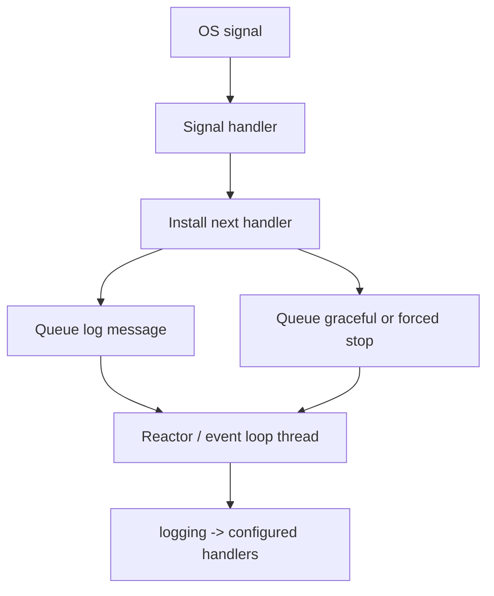
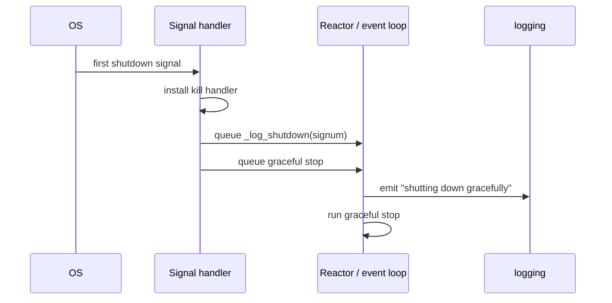

# Design Document

## Overview

**Purpose**: This feature removes logging work from Scrapy's shutdown signal handlers so that a signal which interrupts an in-progress log write can no longer abort the shutdown sequence.

**Users**: Scrapy operators and applications embedding `CrawlerProcess` / `AsyncCrawlerProcess` who stop long-running crawls with Ctrl-C or SIGTERM.

**Impact**: `scrapy/crawler.py` keeps the same handlers, the same escalation order, and the same message text, but emits each shutdown message from the reactor/event-loop thread instead of from the handler body.

### Goals

- No call into the `logging` machinery from a signal handler.
- Shutdown escalation (next handler installed, reactor/loop stop requested) never depends on logging succeeding.
- Message text, level, and destination unchanged for both graceful and forced shutdown, on the Twisted reactor and reactorless paths.

### Non-Goals

- Changing which signals are handled or how they are installed (`scrapy/utils/ossignal.py` is untouched).
- Changing graceful vs forced shutdown policy, timeouts, or exit codes.
- Introducing a signal-safe logging implementation, queueing, or file-descriptor-level `write()`.
- Changing the `CrawlProcess`/`CrawlerRunner` logging configuration.

## Boundary Commitments

### This Spec Owns

- The body of the four signal handlers in `scrapy/crawler.py` and the two logging helpers they call.
- The guarantee that the handlers are logging-free and loop-thread-only for the messages.

### Out of Boundary

- `install_shutdown_handlers` and its SIGINT/SIGTERM/SIGBREAK policy.
- The graceful/forced shutdown state machine (`_graceful_stop_reactor`, `_shutdown_graceful_reactorless`, `_stop_reactor`, `_create_shutdown_task`).
- Log formatters, handlers, and the root logger configuration.

### Allowed Dependencies

- Twisted's `reactor.callFromThread`, already imported lazily inside the reactor-based handlers.
- `asyncio` loop's `call_soon_threadsafe`, already reached through `AsyncCrawlerProcess._reactorless_loop`.
- The module-level `logger` and `signal_names` mapping already used by `_log_shutdown` / `_log_kill`.

### Revalidation Triggers

- New shutdown signals or a change in handler installation.
- A change to when `_reactorless_loop` exists (for example, creating it before handlers are installed).
- Any change to shutdown message text, since tests and users match on it.

## Architecture

### Existing Architecture Analysis

`CrawlerProcessBase` defines `_signal_shutdown` / `_signal_kill` for the Twisted reactor path; `AsyncCrawlerProcess` overrides them with reactorless equivalents. Both paths install the OS handler through `install_shutdown_handlers`, escalate on the second signal, and call a `_log_*` helper before requesting the stop.

The defect: the `_log_*` helpers write through `logging`, and a signal can arrive while the same stream is being written by the interrupted frame, which raises `RuntimeError` inside the handler and skips the stop request.

### Architecture Pattern & Boundary Map

**Architecture Integration**:

- Selected pattern: deferral of the side effect to the thread that owns the stream, using the scheduling primitive already available on each path.
- Domain boundaries: the handler owns escalation only; message emission is a separate, deferred task.
- Existing patterns preserved: lazy reactor import inside the handler, class-level helpers, `install_shutdown_handlers` usage.
- Steering compliance: no new dependency, no new module, minimal diff.

### Technology Stack

| Layer | Choice / Version | Role in Feature | Notes |
|-------|------------------|-----------------|-------|
| Runtime | Python 3.9+ | Signal handlers, asyncio | no new imports required |
| Networking | Twisted reactor | `reactor.callFromThread` | reactor is imported lazily inside the handler |
| Async loop | `asyncio` | `loop.call_soon_threadsafe` | reactorless path only, and only when a loop exists |
| Logging | stdlib `logging` via `scrapy.log` | unchanged message emission | untouched configuration |

## File Structure Plan

### Modified Files

- `scrapy/crawler.py` — defer the `_log_shutdown` / `_log_kill` calls out of the four shutdown handlers; add a short comment stating that logging must not happen in a signal handler and that `_log_shutdown` / `_log_kill` must run on the reactor or event loop thread.

No new files. No test files are modified by this spec; the candidate tests are recorded in `detection-draft.json`.

## System Flows

Ordering decision: the deferred log call is queued before the stop call on both paths, so `callFromThread` / `call_soon_threadsafe` preserve the historical "message first, then stop" order. On the reactorless path the message is queued only after the `None` loop guard, and a missing loop simply skips the message while escalation still happens.

## Requirements Traceability

| Requirement | Summary | Components | Interfaces | Flows |
|-------------|---------|------------|------------|-------|
| 1.1, 1.2, 1.3 | Handler is logging-free and always escalates | `_signal_shutdown`, `_signal_kill`, `_signal_shutdown_reactorless`, `_signal_kill_reactorless` | handler bodies | first-signal, second-signal |
| 1.4 | Message text stays in the `_log_*` helpers | `_log_shutdown`, `_log_kill` | static helpers | both |
| 2.1, 2.2 | Reactor path defers via `callFromThread` | `_signal_shutdown`, `_signal_kill` | Twisted reactor | first/second signal |
| 2.3, 2.4, 2.5 | Reactorless path defers via `call_soon_threadsafe`, guard-aware | `_signal_shutdown_reactorless`, `_signal_kill_reactorless` | asyncio loop | first/second signal |
| 3.1, 3.2, 3.3, 3.4 | Operator-visible messages preserved | `_log_shutdown`, `_log_kill` | logging | both |

## Components and Interfaces

| Component | Domain/Layer | Intent | Req Coverage | Key Dependencies (P0/P1) | Contracts |
|-----------|--------------|--------|--------------|--------------------------|-----------|
| `_signal_shutdown` / `_signal_kill` | CrawlerProcess signal handling | escalate and queue message + stop on the reactor | 1.1-1.3, 2.1, 2.2 | Twisted reactor (P0) | State |
| `_signal_shutdown_reactorless` / `_signal_kill_reactorless` | AsyncCrawlerProcess signal handling | escalate and queue message + stop on the asyncio loop | 1.1-1.3, 2.3-2.5 | asyncio loop (P0) | State |
| `_log_shutdown` / `_log_kill` | Logging helpers | single source of the shutdown message text | 1.4, 3.1-3.4 | module `logger`, `signal_names` (P0) | Service |

#### `_signal_shutdown` (reactor path)

| Field | Detail |
|-------|--------|
| Intent | Queue graceful shutdown and its message on the reactor |
| Requirements | 1.1, 1.2, 1.3, 2.1, 3.1 |

**Responsibilities & Constraints**

- Install `_signal_kill` as the next handler, then queue `_log_shutdown` and `_graceful_stop_reactor` with `reactor.callFromThread`, in that order.
- Must not touch `logging` directly.

**Contracts**: State [x]

**Implementation Notes**

- `from twisted.internet import reactor` stays inside the method to avoid importing the reactor at module import time.

#### `_signal_kill` (reactor path)

| Field | Detail |
|-------|--------|
| Intent | Queue forced shutdown and its message on the reactor |
| Requirements | 1.1, 1.2, 1.3, 2.2, 3.2 |

**Implementation Notes**

- Install `signal.SIG_IGN`, then queue `_log_kill` and `_stop_reactor`.

#### `_signal_shutdown_reactorless`

| Field | Detail |
|-------|--------|
| Intent | Queue graceful shutdown and its message on the asyncio loop |
| Requirements | 1.1, 1.3, 2.3, 2.5, 3.1 |

**Implementation Notes**

- Install `_signal_kill_reactorless`, return early when `self._reactorless_loop` is `None`, then `loop.call_soon_threadsafe(self._log_shutdown, signum)` followed by `loop.call_soon_threadsafe(self._create_shutdown_task)`.

#### `_signal_kill_reactorless`

| Field | Detail |
|-------|--------|
| Intent | Queue forced shutdown and its message on the asyncio loop |
| Requirements | 1.1, 1.3, 2.4, 2.5, 3.2 |

**Implementation Notes**

- Install `signal.SIG_IGN`, return early when there is no loop, then queue `_log_kill` before cancelling the main task so the message is emitted first.

#### `_log_shutdown` / `_log_kill`

| Field | Detail |
|-------|--------|
| Intent | Hold the exact operator-visible message text |
| Requirements | 1.4, 3.1, 3.2, 3.3, 3.4 |

**Contracts**: Service [x]

- Preconditions: called from the reactor or event loop thread, with a valid signal number.
- Postconditions: one `INFO` record is emitted with the unchanged text.

## Error Handling

### Error Strategy

The handler body is reduced to work that cannot fail on a busy stream: attribute reads, `signal.signal` calls, and queueing onto the loop. The only fallible work (formatting and writing a log record) happens later on the loop thread, where an exception cannot truncate the handler's escalation.

### Error Categories and Responses

**System Errors**: a log write that fails on the loop thread is reported by the logging framework's own error handling (`logging.raiseExceptions`) instead of aborting the shutdown.

**Missing loop (reactorless)**: the handler returns after escalation; no message and no shutdown task are queued, matching the pre-existing early return.

### Monitoring

No new monitoring. The two existing `INFO` records remain the observable signal that a shutdown was requested or forced.

## Testing Strategy

- Unit Tests (`tests/test_crawler.py`, `TestAsyncCrawlerProcessReactorlessHelpers`): assert the reactorless handlers escalate to the kill handler / `SIG_IGN`, and assert what is scheduled on the stubbed loop — including that `_log_shutdown` / `_log_kill` are queued with `call_soon_threadsafe` and that nothing is scheduled when there is no loop.
- Integration Tests (`tests/test_crawler_subprocess.py`): run a real crawl in a subprocess, deliver SIGINT (SIGBREAK on Windows), and assert the stderr text "shutting down gracefully" for the Twisted reactor and reactorless paths, plus "forcing unclean shutdown" for the second-signal cases.
- Regression focus: no assertion may require logging to happen inside the handler; the message must be observed through the reactor/loop.
