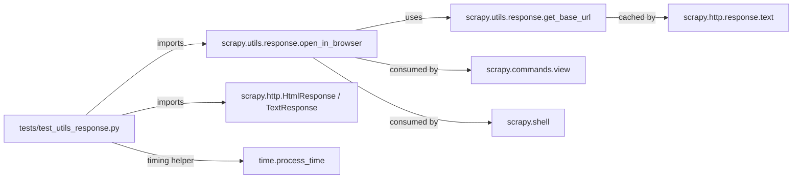

# Design Document

## Overview

This spec covers the test-side repair of the `open_in_browser()` ReDoS
regression tests. The base commit already ships the hardened implementation:
`open_in_browser()` no longer strips HTML comments with `/<!--.*?-->/` and no
longer locates the head element with `(<head(?:>|\s.*?>))`; instead it matches an
optional doctype with the linear `_DOCTYPE_RE` and inserts the `<base>` tag right
after it.

**Purpose**: keep the adversarial payload tests meaningful and non-flaky so the
ReDoS hardening of `open_in_browser()` cannot silently regress.
**Users**: Scrapy maintainers and CI operators.
**Impact**: `tests/test_utils_response.py` only; no runtime change is planned or
required by this spec.

### Goals

- Make the CPU-time assertion in the ReDoS helper robust on slow/loaded hosts.
- Make every exploit payload a real witness for the pattern it guards.
- Keep the existing `open_in_browser()` behaviour coverage intact.
- Record the candidate test files for the detect stage.

### Non-Goals

- Changing `scrapy/utils/response.py` or any other production module.
- Changing the observable `<base>` injection contract.
- Adding new test modules or new test frameworks.

## Boundary Commitments

### This Spec Owns

- The ReDoS regression tests and their timing helper in
  `tests/test_utils_response.py`.
- The candidate test file list produced for this pull request.

### Out of Boundary

- The `open_in_browser()` implementation and its doctype-aware insertion rules.
- Consumers of `open_in_browser()` (`scrapy/commands/view.py`,
  `scrapy/shell.py`) and their end-to-end command tests.
- Any change to test selection tooling or CI configuration.

### Allowed Dependencies

- `pytest`, `time.process_time`, and the helpers already used by
  `tests/test_utils_response.py`.
- `scrapy.http.HtmlResponse` / `TextResponse` and `scrapy.utils.python.to_bytes`.

### Revalidation Triggers

- A change to the regexes used by `open_in_browser()`.
- A change to the `<base>` injection position rules.
- A change to the payload size or the asserted CPU-time budget.

## Architecture

### Existing Architecture Analysis

`open_in_browser(response, _openfunc)` writes an adjusted body to a temporary
file and hands the `file://` URL to the injected `_openfunc`. Tests call it with
a recording `_openfunc` and read the temporary file back through
`_read_browser_output()`, which is why the behaviour tests are file-based rather
than monkeypatched.

The ReDoS contract is expressed as a performance guard, not as an output
assertion: `_assert_open_in_browser_is_fast()` builds an `HtmlResponse` from an
adversarial body, times `open_in_browser()` with `time.process_time`, and asserts
the elapsed CPU time is under a fixed budget.

### Architecture Pattern & Boundary Map



**Architecture Integration**:

- Selected pattern: test-only hardening of an existing unit-test module.
- Domain boundaries: production behaviour stays in `scrapy/utils/response.py`;
  the spec only constrains the regression contract around it.
- Existing patterns preserved: file-backed `_openfunc` assertions, parametrised
  doctype/head cases, `pytest.raises` for type errors.
- New components rationale: none; no new module is introduced.

### Technology Stack

| Layer | Choice / Version | Role in Feature | Notes |
|-------|------------------|-----------------|-------|
| Tests | pytest (repository pin) | Regression and behaviour assertions | No new dependency |
| Timing | `time.process_time` | CPU-time budget for payload runs | Immune to wall-clock jitter |
| Runtime | Python 3.11+ | Executes `open_in_browser()` | Repository default |

## File Structure Plan

### Directory Structure

```
tests/
└── test_utils_response.py   # Only test module that imports open_in_browser
scrapy/utils/
└── response.py              # Implementation under test (unchanged by this spec)
.kiro/specs/
└── open-in-browser-redos-tests/
    ├── spec.json
    ├── requirements.md
    ├── design.md
    ├── research.md
    └── tasks.md
```

### Modified Files

- `tests/test_utils_response.py` — adjust the ReDoS timing helper budget and the
  exploit payloads, keeping the surrounding `open_in_browser()` behaviour tests
  untouched.

## Requirements Traceability

| Requirement | Summary | Components | Interfaces | Flows |
|-------------|---------|------------|------------|-------|
| 1.1-1.5 | Deterministic ReDoS timing | ReDoS helper + two payload tests | `_assert_open_in_browser_is_fast` | payload run through `open_in_browser` |
| 2.1-2.4 | Exploit inputs are real witnesses | comment/head payload tests | payload constants | regex behaviour of the historical patterns |
| 3.1-3.4 | Behaviour coverage preserved | behaviour tests in same module | `_read_browser_output`, `open_in_browser` | temp-file round trip |
| 4.1-4.3 | Candidate test files recorded | detect stage | `/output/detection-draft.json` | import/call-graph scan |

## Components and Interfaces

| Component | Domain/Layer | Intent | Req Coverage | Key Dependencies | Contracts |
|-----------|--------------|--------|--------------|------------------|-----------|
| ReDoS payload tests | Tests | Assert bounded CPU time for adversarial HTML | 1, 2 | `_assert_open_in_browser_is_fast`, `HtmlResponse` | Test functions |
| Behaviour tests | Tests | Pin `<base>` injection and response-type mapping | 3 | `_read_browser_output` | Test functions |
| Detection draft | SDD detect stage | Record candidate test files | 4 | repository import graph | JSON draft |

### Tests

#### ReDoS payload tests

| Field | Detail |
|-------|--------|
| Intent | Fail fast if `open_in_browser()` becomes super-linear on adversarial input |
| Requirements | 1.1, 1.2, 1.3, 2.1, 2.2 |

**Responsibilities & Constraints**

- Own the payload constants and the CPU-time budget.
- Must not assert on generated output, only on elapsed CPU time.

**Dependencies**

- Inbound: none (leaf test module).
- Outbound: `scrapy.utils.response.open_in_browser` — subject under test
  (Critical).

**Contracts**: Service [ ] / API [ ] / Event [ ] / Batch [ ] / State [ ]

##### Service Interface

```python
def _assert_open_in_browser_is_fast(body: bytes) -> None: ...
def test_open_in_browser_redos_comment() -> None: ...
def test_open_in_browser_redos_head() -> None: ...
```

- Preconditions: `body` is a bytes payload accepted by `HtmlResponse`.
- Postconditions: returns only when CPU time stayed under the budget.
- Invariants: the budget is expressed in CPU seconds and documented inline.

**Implementation Notes**

- Validation: keep the payload large enough that a vulnerable regex needs
  seconds while a linear implementation stays in the low milliseconds.
- Risks: budgets that are too tight reintroduce flakiness; budgets that are too
  loose stop detecting regressions.

## Testing Strategy

### Unit Tests

- `test_open_in_browser_redos_comment` and `test_open_in_browser_redos_head` —
  adversarial payloads must complete under the CPU-time budget.
- `test_inject_base_url` (parametrised) — doctype, comment, head-less, and
  misleading-head bodies.
- `test_open_in_browser` — `<base>` tag is present and non-text `Response`
  raises `TypeError`.
- `test_get_base_url`, `test_get_meta_refresh`, `test_response_status_message` —
  remainder of the module under test.

### Integration Tests

- Not owned by this spec. `scrapy view` / `scrapy shell` end-to-end coverage
  lives in `tests/test_commands.py` and `tests/test_command_shell.py` and is only
  relevant if the production contract changes.

### Performance/Load

- Payload runs are the performance guard: a vulnerable implementation must take
  seconds on these inputs, a hardened one low milliseconds.

## Test Detection Plan (Detect Stage Output)

The detect stage scans the import/call graph of the module touched by the
requests:

1. `scrapy/utils/response.py` defines `open_in_browser`; the only test module
   that imports it is `tests/test_utils_response.py`.
2. That module also imports `get_base_url`, `get_meta_refresh`, and
   `response_status_message` from the same file, so all tests in the module are
   in scope.
3. Consumers (`scrapy/commands/view.py`, `scrapy/shell.py`) are covered by
   command-level tests that do not exercise the ReDoS paths; they are recorded
   as adjacent, not as candidates.

| Candidate | Symbols | Why |
|-----------|---------|-----|
| `tests/test_utils_response.py` | `test_open_in_browser_redos_comment`, `test_open_in_browser_redos_head`, `_assert_open_in_browser_is_fast`, `test_open_in_browser`, `test_inject_base_url`, and the remaining `test_open_in_browser_*` cases | Only module importing `open_in_browser`; contains both the flaky timing helper / exploit payloads and the behaviour tests that must keep passing |
