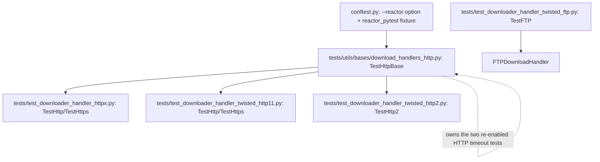

# Design Document

## Overview

**Purpose**: This change restores three tests that are currently compensated for by `DirtyReactorAggregateError` skip guards, so that scrapy's HTTP and FTP download-handler timeout/authentication coverage is active again on the Windows + asyncio-reactor configuration.

**Users**: scrapy maintainers and CI operators who run the test suite with `--reactor asyncio` on Windows and rely on the suite's skip counts as a signal of untested configurations.

**Impact**: The change removes three inline skip guards and one now-unused import in the existing test suite. No production code, no test body, and no reactor configuration is modified.

### Goals

- The three annotated tests execute instead of reporting a `DirtyReactorAggregateError`-based skip.
- The suite stays lint-clean and import-clean after the guards are deleted.
- Coverage for HTTP download timeouts and FTP authentication is restored without altering test assertions.

### Non-Goals

- Investigating or fixing Twisted ticket 10279 or any underlying dirty-reactor leak.
- Changing reactor policy in `conftest.py` (`set_asyncio_event_loop_policy`, `--reactor` handling).
- Re-enabling any other skipped test that is not annotated with a `DirtyReactorAggregateError` comment.

## Boundary Commitments

### This Spec Owns

- The three `DirtyReactorAggregateError` guard blocks and the tests they guard.
- Import hygiene inside the two touched test modules.
- The claim that these three tests are the complete set of `DirtyReactorAggregateError`-annotated skips at the base commit.

### Out of Boundary

- Production behavior of `FTPDownloadHandler` and the HTTP download handlers.
- Reactor selection, loop policy, and collection hooks in `conftest.py`.
- The concrete subclass modules that inherit the base-class tests; they are read as evidence but are not edited.

### Allowed Dependencies

- The existing `reactor_pytest` fixture defined in `conftest.py` (kept for other tests; no longer referenced by the three guards).
- The `pytest` import already present in both modules (used by other tests and markers).
- The base classes `TestHttpBase` / `TestFTPBase` and their concrete subclasses.

### Revalidation Triggers

- Any change to the `--reactor` options or to `reactor_pytest` fixture semantics.
- Adding a new download-handler base class or subclass that overrides the three tests.
- A Twisted upgrade that reintroduces `DirtyReactorAggregateError` for these paths.

## Architecture

### Existing Architecture Analysis

The scrapy test suite is organised as abstract base classes under `tests/utils/bases/` plus thin concrete modules that bind a handler implementation and are marked `requires_reactor`. `--reactor` is a session option exposed through the `reactor_pytest` fixture, so platform/reactor-specific skips are written as early `pytest.skip(...)` statements inside the test body. The three skip sites in scope follow exactly that pattern.

### Architecture Pattern & Boundary Map

**Architecture Integration**:

- Selected pattern: in-place test-suite maintenance (no new modules, no abstractions).
- Domain boundaries: the base module owns the shared HTTP timeout tests; the FTP module owns its own concrete test; concrete downloader modules always own the execution entry point of inherited tests.
- Existing patterns preserved: early-return/early-skip guards inside test bodies, `pytestmark` at module level, `requires_reactor` markers.
- New components rationale: none, intentionally.

### Technology Stack

| Layer | Choice / Version | Role in Feature | Notes |
|-------|------------------|-----------------|-------|
| Test runner | pytest + pytest-twisted (`--reactor` option) | Collects and runs the three tests | Session-scoped `reactor_pytest` fixture |
| Test transport | Twisted (`twisted.protocols.ftp`, HTTP handlers) | Provides the reactor and protocols under test | Ticket 10279 is the historical cause of the skips |

## File Structure Plan

### Modified Files

- `tests/utils/bases/download_handlers_http.py` — delete the two `if reactor_pytest == "asyncio" and sys.platform == "win32": pytest.skip(...)` blocks at the top of `TestHttpBase.test_timeout_download_from_spider_nodata_rcvd` and `TestHttpBase.test_timeout_download_from_spider_server_hangs`, together with the `# https://twistedmatrix.com/trac/ticket/10279` comments attached to them. Keep the `sys` import: it is still used at lines 608, 934 and 950.
- `tests/test_downloader_handler_twisted_ftp.py` — delete the equivalent guard at the top of `TestFTP.test_invalid_credentials` and drop the now-unused `import sys` (its only use in this module is the removed guard).

No files are created. No production module under `scrapy/` is touched.

## Requirements Traceability

| Requirement | Summary | Components | Interfaces | Flows |
|-------------|---------|-----------|------------|-------|
| 1.1-1.3 | HTTP timeout tests execute with unchanged assertions | `TestHttpBase` timeout tests | pytest collection (`--reactor asyncio`) | Collection → test body → `DownloadTimeoutError` assertion |
| 2.1-2.3 | FTP invalid-credentials test executes with unchanged assertion | `TestFTP.test_invalid_credentials` | pytest collection (`--reactor asyncio`) | Collection → test body → `ConnectionLost` assertion |
| 3.1-3.3 | No new skips on other configurations; failures surface | Both touched modules | `pytestmark`, `reactor_pytest` fixture | Default-reactor and non-Windows runs |
| 4.1-4.3 | Module hygiene | Both touched modules | Python imports | Import-only cleanup |

## Components and Interfaces

| Component | Domain/Layer | Intent | Req Coverage | Key Dependencies (P0/P1) | Contracts |
|-----------|--------------|--------|--------------|--------------------------|-----------|
| `TestHttpBase` timeout tests | Test base class | Restore HTTP timeout coverage | 1, 3, 4 | `MockServer`, `reactor_pytest` (P0) | pytest test function |
| `TestFTP.test_invalid_credentials` | Concrete test | Restore FTP auth-error coverage | 2, 3, 4 | `FTPFactory`/`FTPRealm`, `reactor_pytest` (P0) | pytest test function |

### Test Suite

#### `TestHttpBase` timeout tests

| Field | Detail |
|-------|--------|
| Intent | Verify that HTTP download handlers raise `DownloadTimeoutError` for stalled transfers |
| Requirements | 1.1, 1.2, 1.3, 3.1, 3.2, 3.3, 4.2, 4.3 |

**Responsibilities & Constraints**

- Owns the two timeout scenarios and their `download_timeout` meta settings; the guard removal must not alter `meta` or assertion structure.
- The tests are defined on an `ABC` and executed only through concrete subclasses, so correctness of the change is judged on subclass runs.

**Implementation Notes**

- Validation: confirm by collection/`--collect-only` reasoning that the two tests are no longer skipped; static check that `sys` remains used in the module.
- Risks: the guards may still be needed on real Windows CI; a genuine `DirtyReactorAggregateError` would now surface as a failure (accepted per Requirement 3.3).

#### `TestFTP.test_invalid_credentials`

| Field | Detail |
|-------|--------|
| Intent | Verify that invalid FTP credentials raise `ConnectionLost` |
| Requirements | 2.1, 2.2, 2.3, 3.1, 3.2, 3.3, 4.1, 4.3 |

**Responsibilities & Constraints**

- Owns its own setup (`meta` with bad password) and the `pytest.raises(ConnectionLost)` assertion; only the leading guard is removed.

**Implementation Notes**

- Validation: module import cleanliness (`sys` no longer referenced) and unchanged assertion behavior.
- Risks: `sys` removal must not break other references in the module — there are none after the guard is deleted.

## Testing Strategy

- Unit/integration tests: the re-enabled tests themselves — `TestFTP.test_invalid_credentials` and the two `TestHttpBase` timeout tests executed through the httpx, HTTP/1.1 and HTTP/2 modules.
- Configuration coverage: a default-reactor run to confirm no behavior change, plus an `--reactor asyncio` collection check to confirm the skip count drops.
- Hygiene checks: `ruff`/`flake8`-style unused-import detection on the two touched files.
- Explicitly not run in this stage: no tests are executed, because the Detect stage is read-only with respect to the repository.
